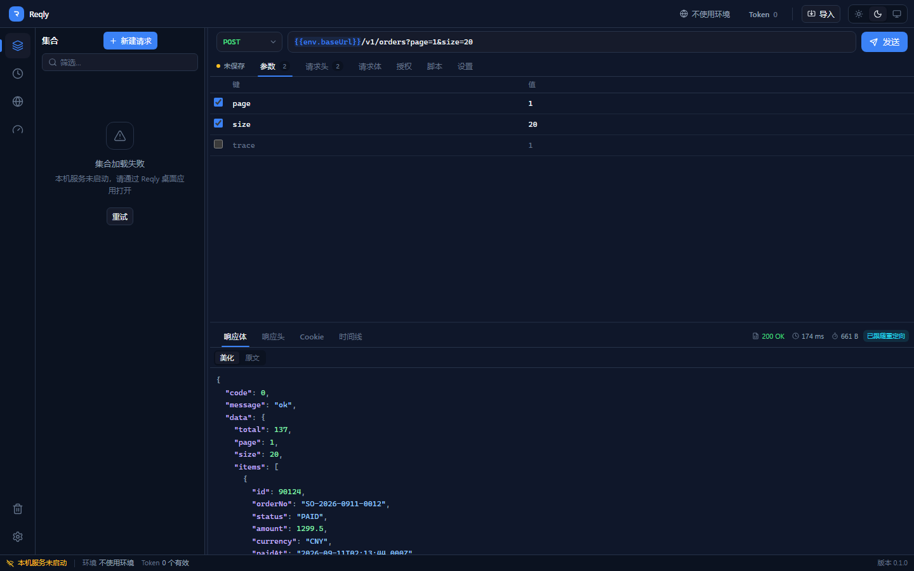
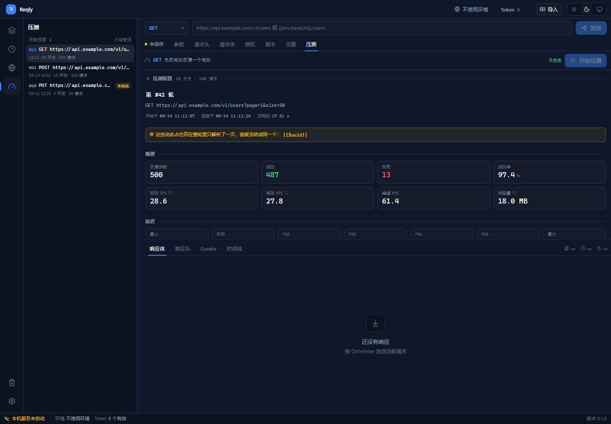
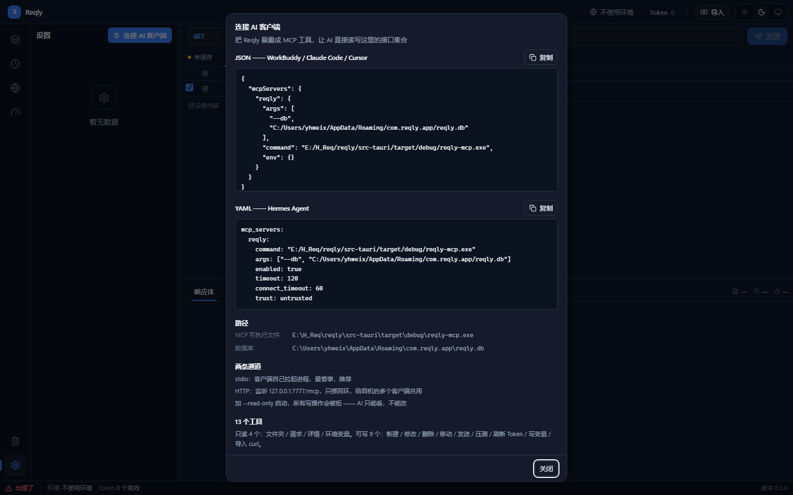

<div align="center">

# Synapse

**Agent 原生的 API 工作台**

单文件安装包 5.5 MB · 本地优先 · 无账号 · 无遥测

[](https://github.com/yanghuiwei/Synapse/releases)
[](LICENSE)
[](https://tauri.app)
[](https://www.rust-lang.org)

[下载](https://github.com/yanghuiwei/Synapse/releases) · [接上 AI](#三接上-ai-客户端) · [从源码构建](#从源码构建) · [设计文档](docs/design.md)

</div>

---

## 一、这是什么

Postman 很重、要登录、要云同步。更要命的是：**它是给人点的，不是给 AI 调的。**

Synapse 把两件事同时做干净：

| | |
|---|---|
| **管好日常 API 工作** | 集合、环境变量、Token 源、历史、压测、导入 —— 该有的都有 |
| **把同一份数据交给 AI** | MCP Server 或 CLI，让 Claude Code / Cursor / WorkBuddy 自己找接口、改参数、发请求、看响应 |

关键在于**同一份数据**：桌面端和 AI 读写的是同一个 SQLite 文件。AI 建了一个请求，桌面端 1 秒内自己刷新出来 —— 不是把 curl 贴进对话框，是 **AI 自己动手**。

应用内不内置聊天框、不配 LLM provider。AI 从外面进来，Synapse 只负责干净的数据和干净的通道。

> 项目代号 `reqly`，产品名 Synapse。仓库里 `reqly-*` 是二进制与 crate 名，`Synapse` 是用户看到的名字。

---

## 二、对比优势

### 对比同类

| | Postman | Apifox | Insomnia | **Synapse** |
|---|:--:|:--:|:--:|:--:|
| 安装包体积 | ~90 MB | ~120 MB | ~30 MB | **5.5 MB** |
| 需要账号 | ✅ | ✅ | ❌ | ❌ |
| 云同步 / 遥测 | 默认开 | 默认开 | 可关 | **都没有** |
| AI 直接操作接口 | ❌ | 云端 Agent | MCP ✅ | **MCP + CLI** |
| 大响应体落文件 | — | — | ❌ | ✅（CLI） |
| 脚本 / 管道友好 | ❌ | ❌ | 部分 | ✅ `--json \| jq` |
| 离线完全可用 | 部分 | ❌ | ✅ | ✅ |
| 开源 | ❌ | ❌ | ✅ | ✅ |

### 真正不一样的地方

**① 体积不是压出来的，是架构决定的**

`reqly-mcp.exe` 只读写一个 SQLite 文件，却曾因为 bin target 挂在桌面 crate 下而一路链上 Tauri —— **21.5 MB**。拆成workspace 四个 crate 后降到 **7.7 MB**：

```
reqly          桌面端（tauri + 命令层）
├─ reqly-core  三入口共用的核心层 —— 不含 tauri / rmcp / axum
├─ reqly-mcp   MCP Server（+ rmcp + axum）      7.7 MB
└─ reqly-cli   命令行（+ clap）                  5.7 MB
```

再加 LTO + `codegen-units=1` + `strip` + 静态链接 CRT。**MCP 和 CLI 各带各的依赖，谁也不拖着谁。**

**② 依赖干净到能直接扔进内网**

TLS 走 rustls + **系统根证书**（不是 webpki 内置清单）。企业内网常见「用公司根证书做中间人代理」的网关 —— 换证书库这一下，就是能不能访问的区别。零 OpenSSL、零 SQLite 动态库、零 VC++ 可再发行包。

**③ 外部改动自动同步**

盯的是 SQLite 自己的 `PRAGMA data_version` 计数器，而不是文件 mtime（Windows 上精度到 15ms，连写两次只看见一次）。AI 在另一个进程改了库，桌面端 1 秒内刷新，**不用重启**。

**④ 对外只给错误码，不给文案**

**28 个稳定错误码**（`E_TIMEOUT` / `E_DNS` / `E_TLS` / `E_DB_LOCKED` / `E_TOKEN_EXPIRED` …），并标注哪些可重试。AI 能据此决策，文案爱怎么改怎么改，不破契约。

**⑤ 导入不静默丢弃**

认不出的命令行参数、解不出的字段、被丢弃的脚本，一律进导入警告，在预览界面里列给你看。**静默丢弃是最坏的结果** —— 你会以为导进来了，直到调接口那天才发现少了东西。

---

## 三、功能一览

| 模块 | 能力 |
|---|---|
| **集合管理** | 无限层级文件夹，拖拽排序，全局搜索，命令面板 |
| **请求闭环** | 全方法支持，查询/头/表单/原始体/二进制/GraphQL，20+ 类网络错误分开报 |
| **环境变量** | `{{var}}` 占位符，secret 恒不回显，`{{$uuid}}` 等动态函数 |
| **Token 源** | 绑到文件夹，自动刷新，并发单飞（航班锁），剩余有效期可视 |
| **历史与回收站** | 全局软删除，误删可还原 |
| **压测** | 并发可控，P50/P90/P95/**精确**分位 + TPS + 错误分布，导出独立 HTML 报表 |
| **导入** | curl、Postman v2.1、ApiPost、HAR 1.2、自有 JSON —— 导入前出差异树 |
| **MCP / CLI** | AI 双通道，共用同一份数据 |
| **外观** | 亮/暗主题 + 5 套强调色，主题与强调色是两个正交维度 |
| **窗口** | 自绘标题栏，去掉系统标题栏 |

### 支持的导入格式

| 格式 | 来源 |
|---|---|
| **curl** | 终端复制、文档、聊天记录 |
| **Postman v2.1** | Postman 导出的 collection |
| **ApiPost** | ApiPost 原生导出 |
| **HAR 1.2** | 浏览器 DevTools / Charles / Fiddler |
| **Synapse JSON** | 自己的备份格式 |

导入流水线：`detect() 指纹识别 → parse() 解析 → 预览差异树（+新增 / ~更新 / =跳过）→ commit 落库`。

---

## 四、快速开始

### 4.1 装桌面端

从 [Releases](https://github.com/yanghuiwei/Synapse/releases) 下载对应平台安装包，安装即用。

Windows 安装器会自动把安装目录加进用户 PATH —— **装完新开一个终端**就能敲 `reqly-cli`。

<details>
<summary><b>界面速览</b></summary>

| 集合与请求 | 压测报表 | MCP 接入 |
|---|---|---|
|  |  |  |

</details>

### 4.2 接上 AI 客户端

打开 **设置 → MCP**，面板会给出**与当前安装路径匹配**的片段，直接粘进客户端配置。

<details open>
<summary><b>Claude Code / Cursor / WorkBuddy（JSON）</b></summary>

```jsonc
// mcpServers
{
  "reqly": {
    "command": "C:/Users/<you>/AppData/Local/Synapse/reqly-mcp.exe",
    "args": ["--db", "C:/Users/<you>/AppData/Roaming/com.reqly.desktop/reqly.db"],
    "env": {}
  }
}
```

</details>

<details>
<summary><b>Hermes Agent（YAML）</b></summary>

只粘 `reqly:` 这一段，**不要连 `mcp_servers:` 头一起**。

```yaml
reqly:
  command: "C:/Users/<you>/AppData/Local/Synapse/reqly-mcp.exe"
  args: ["--db", "C:/Users/<you>/AppData/Roaming/com.reqly.desktop/reqly.db"]
  enabled: true
  timeout: 120
  connect_timeout: 60
  trust: untrusted
```

</details>

> **路径一律输出正斜杠。** YAML 双引号里 `\U` 不是合法转义，`\t` / `\n` 却恰好合法 —— 后者会让路径被静默改写成带制表符的字符串，配置文件看着没问题、进程却找不到文件。

接上之后 AI 就有 **13 个 tool**：

| 分类 | tool |
|---|---|
| 浏览 | `list_folders` `list_requests` `get_request` `list_environments` |
| 编辑 | `create_request` `update_request` `move_request` `delete_request` |
| 执行 | `send_request` `run_load_test` |
| Token | `refresh_token` |
| 变量 | `set_env_var` |
| 导入 | `import_curl` |

`delete_request` 是**软删除**（进回收站，桌面端可还原）。secret 变量和 access token **永不过 MCP 通道** —— `refresh_token` 只回有效期。

### 4.3 CLI 速览

CLI 需要知道库在哪：`--db` 指定，或设一次环境变量 `REQLY_DB`（桌面端「设置」页能直接看到绝对路径）。

```bash
export REQLY_DB="$APPDATA/com.reqly.desktop/reqly.db"    # Windows，或每次传 --db

reqly-cli folders                                   # 列出集合
reqly-cli requests list --json | jq '.requests[] | .name'
reqly-cli send --request-id 151                     # 发一条已保存的请求
reqly-cli send 151 --max-body-bytes 0 > resp.json   # 大响应不截断，直接落文件
reqly-cli env list                                  # 看当前环境变量（secret 恒为 ••••）
reqly-cli --help                                    # 全部 7 组子命令
```

7 组子命令：`folders` `requests` `env` `send` `loadtest` `token` `import`

全局开关：

| 开关 | 作用 |
|---|---|
| `--db <PATH>` | 库路径（也可用 `REQLY_DB`）；文件不存在会新建空库 |
| `--json` | stdout 只出一份 JSON，形状与 MCP 返回一致 |
| `--read-only` | 11 个写操作一律返回 `E_READ_ONLY`，不碰库 |
| `--max-body-bytes <N>` | 响应体截断上限，`0` = 不在这一层截 |

退出码：`0` 成功 · `1` 业务失败（具体错误码在 stderr）· `2` 命令行写错了。
脚本按 `1` / `2` 区分「业务失败」与「调用方式不对」—— 前者改数据，后者改命令。

> **输出约定：数据一律走 stdout，日志一律走 stderr。** 所以 `--json` 可以放心直接管道给 `jq`。

### 4.4 MCP 还是 CLI？

| | MCP Server | CLI |
|---|---|---|
| 适合 | 边聊边查，AI 自己找接口 | 脚本、管道、批处理 |
| 传输 | JSON-RPC（stdio / 127.0.0.1 HTTP） | 进程 stdout |
| 响应体 | 硬截 64KB | `--max-body-bytes 0` 可不截，适合落文件 |
| 上下文成本 | 13 个 tool schema 常驻 | 零，`--help` 现查 |
| 只读模式 | `--read-only` | `--read-only` |

**不是二选一：查和聊走 MCP，批处理和管道走 CLI。**

MCP 也支持 HTTP 通道（只绑回环，不对外）：

```bash
reqly-mcp --db <path> --http --port 7777
```

---

## 五、从源码构建

需要：**Node.js `^20.19.0 || >=22.12.0`** · **pnpm** · **Rust stable** · **MSVC 生成工具**
（Windows 上由 Visual Studio 2022 / VS Build Tools 提供，勾选「使用 C++ 的桌面开发」）

```bash
git clone https://github.com/yanghuiwei/Synapse.git
cd Synapse
pnpm install

pnpm tauri dev       # 开发
pnpm tauri build     # 出安装包
```

分开构建两个 sidecar：

```bash
pnpm mcp:build       # reqly-mcp.exe
pnpm cli:build       # reqly-cli.exe
```

> Windows 目标三元组是 `x86_64-pc-windows-msvc`，**编译期需要 MSVC 链接器**（`link.exe`）。
> 但这只是构建依赖 —— 产出物静态链接了 VC 运行时（`static_vcruntime`），
> **终端用户不需要装 VS，也不需要 VC++ 可再发行包。**

---

## 六、技术栈

**桌面端** React 19 · TypeScript · Tailwind v4 · zustand · uplot · Tauri 2

**核心** Rust · SQLite（bundled）· reqwest（rustls + 系统根证书）· tokio · rusqlite + r2d2

**AI 通道** rmcp（JSON-RPC / stdio / axum 回环 HTTP）· clap

### 架构分层

```
┌─────────────┐  ┌──────────────┐  ┌────────────┐
│ reqly       │  │ reqly-mcp    │  │ reqly-cli  │
│ 桌面端       │  │ MCP Server   │  │ 命令行     │
│ + tauri     │  │ + rmcp/axum  │  │ + clap     │
└──────┬──────┘  └──────┬───────┘  └─────┬──────┘
       │                │                │
       └────────────────┴────────────────┘
                        │
              ┌─────────▼──────────┐
              │    reqly-core      │
              │  不含 tauri/rmcp/axum│
              │  错误码 · 存储 · HTTP│
              │  模板 · 压测 · 导入  │
              └─────────┬──────────┘
                        │
                  ┌─────▼─────┐
                  │  reqly.db │  单文件
                  └───────────┘
```

三个入口唯一的差别是**谁来触发、结果怎么呈现**。共用的编排逻辑只有一份实现（`service::ops`，15 个操作），MCP 暴露其中 13 个给 AI，CLI 全给。

---

## 七、文档

| 文档 | 内容 |
|---|---|
| [设计文档](docs/design.md) | 定位、决策记录、数据模型、模块设计 |
| [压测精度校准](docs/ab-calibration-p6.txt) | 内置引擎 vs ApacheBench 的分位数配对实测 |
| [docs 说明](docs/README.md) | 目录里还有什么、各自是什么 |

代码里的注释密度不低，几个核心 crate 的模块头文档（`lib.rs` / `server.rs` / `ops.rs`）值得一读，那里有不少「为什么这么写」的记录 —— 特别是几处**本地验不出来、只有真实环境才暴露**的问题是怎么处理的。

---

## 八、贡献

欢迎参与。动手前请读 [贡献指南](CONTRIBUTING.md) —— 里面写了本地要过哪些门禁，
以及一条容易踩的坑：别在三个平台共用的 crate 里引入只在 Windows 上成立的依赖
（本机验不出来，只有 Linux CI 会红）。

```bash
git checkout -b feat/your-feature
# ...
git commit -s -m "feat(scope): 一句话说清做了什么"
```

提交信息跟随 [Conventional Commits](https://www.conventionalcommits.org/)，发版由 [release-please](https://github.com/googleapis/release-please) 自动化 —— **版本号和 CHANGELOG 不要手改**。

参与即表示同意遵守 [行为准则](CODE_OF_CONDUCT.md)。
发现安全问题见 [安全策略](SECURITY.md) —— **不要**用公开 Issue 报告。

| | |
|---|---|
| 🐛 [报告 Bug](.github/ISSUE_TEMPLATE/bug_report.yml) | 请附上「你是怎么发现的」 |
| 💡 [功能请求](.github/ISSUE_TEMPLATE/feature_request.yml) | 先说问题，别直接跳到方案 |
| ❓ [配置问题](.github/ISSUE_TEMPLATE/config.yml) | 安装 / 接 MCP / 构建 |

---

## 九、许可证

[MIT](LICENSE) © 2026 yhweix

可以自由使用、复制、修改、合并、发布、分发、再许可与销售 —— 包括商业用途。唯一的义务是**在副本或实质性部分里保留版权声明与许可声明**。

软件按「原样」提供，不附带任何明示或暗示的担保。